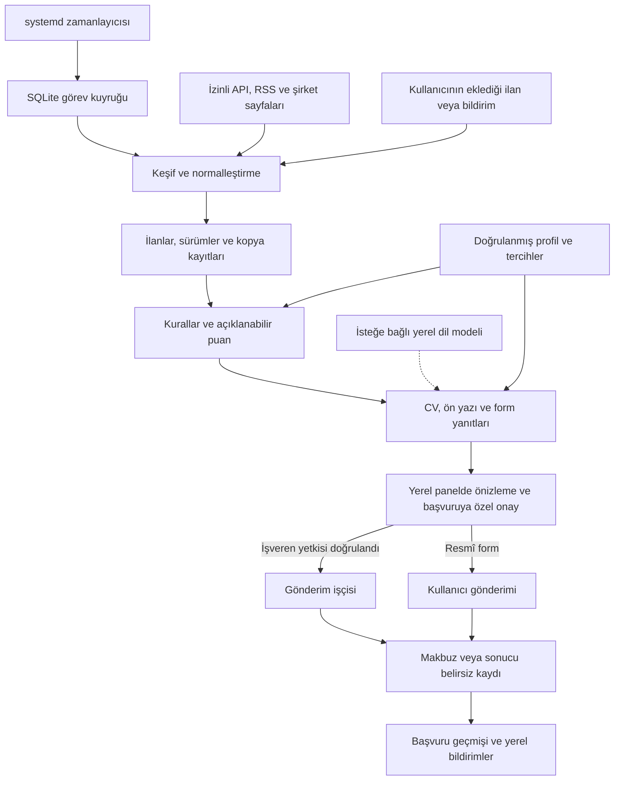

# İş ilanı keşfi, eşleştirme ve onaylı başvuru mimarisi

**Kaynak kontrol tarihi:** 18 Kasım 2026  
**Kapsam:** Teknik araştırma, mimari kararlar ve Codex uygulama planı

## 1. Yönetici özeti

**Önerilen mimari, mevcut bilgisayarda çalışan Python + SQLite tabanlı tek bir uygulamadır.** Uygulama izinli kaynaklardan ilan toplar, aynı pozisyonun farklı kopyalarını ilişkilendirir, ilanları doğrulanmış aday profiliyle eşleştirir ve başvuru paketini hazırlar. Yerel panel, ilanın neden önerildiğini, hangi koşulların belirsiz kaldığını ve işverene hangi bilgilerin gönderileceğini gösterir.

**İlk kullanılabilir sürüm Greenhouse, Lever ve We Work Remotely RSS ile başlar.** Greenhouse ve Lever, takip edilen şirketlerin ilanlarını okumayı sağlar. WWR RSS, takip listesinin dışındaki şirketleri keşfetmeye yarar. Greenhouse ve Lever üzerinden API ile başvuru göndermek, işveren tarafında üretilen anahtar ve ilgili yetkiyi gerektirir. Varsayılan akışta kullanıcı hazırlanan paketle resmî formu tamamlar. Yetkili entegrasyon bulunan işverenlerde panel, başvuruya özel insan onayından sonra gönderimi üstlenebilir. [Greenhouse Job Board API](https://docs.greenhouse.io/job-board) · [Lever Postings API](https://github.com/lever/postings-api) · [We Work Remotely RSS](https://weworkremotely.com/remote-job-rss-feed)

Tasarım, tek aday, mevcut bir bilgisayar ve internet bağlantısı, ilk dağıtım için Linux ve Türkçe/İngilizce ilanları varsayar. Gerçek CV, hedef şirketler, donanım ve işveren entegrasyon yetkileri kurulum girdileridir. Kapasite tahminleri ve kalite eşikleri Codex’in doğrulayacağı tasarım hedefleridir. Temel akış ücretli API, GPU, alan adı, bulut hesabı veya dil modeli gerektirmez.

## 2. Teknoloji araştırması ve seçimler

| İhtiyaç | Seçim | Gerekçe ve değerlendirilen alternatif |
|---|---|---|
| Uygulama ve entegrasyon | Python 3.12, HTTPX, Pydantic | Kaynak verileri ortak şemaya dönüştürür. Komut satırı, panel ve test aynı ayrıştırıcıları kullanır. [HTTPX](https://github.com/encode/httpx) |
| Zamanlama | `systemd.timer` ve kalıcı iş kuyruğu | `Persistent=true`, bilgisayar kapalıyken kaçan takvim tetiklemesini yeniden açılışta telafi eder. APScheduler süreç içi zamanlama, Prefect ise ayrı bir iş akışı sunucusu gerektiğinde değerlendirilebilir. [systemd.timer](https://www.freedesktop.org/software/systemd/man/latest/systemd.timer.html) · [APScheduler](https://apscheduler.readthedocs.io/en/3.x/userguide.html) · [Prefect](https://github.com/PrefectHQ/prefect) |
| Veri | SQLite, SQLAlchemy, Alembic | Tek kullanıcı ve kısa yazma işlemleri için ayrı sunucu gerektirmez. Onay ve gönderim girişimi tek işlemde kaydedilebilir. Birden fazla makinede yazma ihtiyacı doğarsa geçiş hedefi PostgreSQL olur. [SQLite işlemleri](https://www.sqlite.org/lang_transaction.html) · [Alembic](https://github.com/sqlalchemy/alembic) |
| Panel ve belgeler | FastAPI, Jinja2, ReportLab, `python-docx` | Yerel panel, seçilebilir metin içeren tek sütunlu PDF, düzenlenebilir DOCX ve düz metin yanıtlar. PDF’ye Türkçe karakterleri destekleyen yerel font gömülür. [FastAPI şablonları](https://fastapi.tiangolo.com/advanced/templates/) · [ReportLab font desteği](https://docs.reportlab.com/reportlab/userguide/ch3_fonts/) |
| Tarayıcı | İsteğe bağlı Playwright + Chromium | İzinli formlarda erişilebilir rol ve alan etiketiyle doldurma, sahte portallarda uçtan uca test. Standart keşif HTTP veya RSS üzerinden yürür. [Playwright Python](https://github.com/microsoft/playwright-python) · [Alan seçicileri](https://playwright.dev/python/docs/locators) |
| Görsel orkestrasyon | Alternatif olarak n8n Community | Kendi sunucunda ücretsiz çalışır. Sustainable Use License kişisel kullanıma izin verir. Haricî sır yönetimi ve bazı yönetim özellikleri ücretli sürümlerdedir. [n8n lisansı](https://github.com/n8n-io/n8n/blob/master/LICENSE.md) · [Community özellikleri](https://docs.n8n.io/hosting/community-edition-features/) |
| Paketleme | `uv` ve kilitli bağımlılıklar | İlk dağıtım yerel Python ortamıyla yapılır. Docker Engine ve Compose, kurulumu başka makineye taşımak için kullanılabilir. Docker Desktop kişisel kullanımda ücretsizdir, kurumsal koşulları farklıdır. [uv](https://docs.astral.sh/uv/guides/projects/) · [Docker lisansı](https://docs.docker.com/subscription-billing/desktop-license/) |

## 3. Sıfır ek maliyetin uygulanabilirliği

| Çalıştırma biçimi | Gerçek sınır | Karar |
|---|---|---|
| Mevcut bilgisayar | Abonelik ve API faturası yok. Ek açık kalma süresi elektrik tüketir. Örneğin günde 4 saat ek 15 W tüketim, ayda yaklaşık 1,8 kWh eder. | **Ana dağıtım.** Taramaları bilgisayarın zaten açık olduğu saatlere yerleştir. |
| GitHub Actions | Açık depolarda standart barındırılan çalıştırıcılar ücretsizdir. GitHub Free özel depolarda aylık **12 ABD doları eşdeğerinde ortak işlem hakkı** ve **500 MB Actions depolaması** listeliyor. Zamanlanan işler yoğunlukta gecikebilir veya düşebilir. | İsteğe bağlı, yalnızca sentetik verili CI testleri. Kota biterse testler yerelde çalışır. [GitHub kotaları](https://docs.github.com/en/billing/reference/product-usage-included) · [Actions faturalandırması](https://docs.github.com/en/billing/concepts/product-billing/github-actions) · [Zamanlama sınırları](https://docs.github.com/en/actions/reference/workflows-and-actions/events-that-trigger-workflows#schedule) |
| Ücretsiz bulut sunucusu | Google Cloud belirli ABD bölgelerinde ayın saatleri kadar `e2-micro`, 30 GB-ay standart disk ve koşullu 1 GB ağ çıkışı sunuyor. Hesap, bölge ve aşım koşulları var. Oracle Always Free kaynaklarında bölgesel kapasite bulunamayabilir ve atıl makineler geri alınabilir. | Sürekli açık kişisel bilgisayarı olmayanlar için izinli ilan keşfi seçeneği. [Google Cloud ücretsiz katmanı](https://cloud.google.com/free/docs/free-cloud-features) · [Oracle Always Free](https://docs.oracle.com/en-us/iaas/Content/FreeTier/freetier_topic-Always_Free_Resources.htm) |
| Hibrit dağıtım | Bulut yalnızca herkese açık ilan kimliklerini tutar. Yerel uygulama bu kayıtları içeri alır. Senkronizasyon ve ikinci bir bakım noktası oluşur. | Bilgisayar kapalıyken ilan kaçırıldığı ölçülürse eklenir. CV, oturum, belgeler ve gönderim yerelde kalır. |

Model indirmeleri, Chromium, belgeler ve yedekler disk tüketir. İlk sürümün kabul koşulu, **ücretli hesap açmadan ve model indirmeden** keşif, eşleştirme, belge üretimi, onay ve manuel takip akışını tamamlayabilmektir.

## 4. Üç uygulanabilir mimari

| Mimari | Yerleşim ve kapsam | Bakım ve güvenilirlik | Başlangıç donanım tahmini |
|---|---|---|---|
| **A. n8n merkezli** | n8n zamanlayıcı, HTTP/RSS düğümleri, yerel PostgreSQL, belge üreticisi ve onay formu. Yetkili API’ye onay sonrası gönderim yapabilir. | Görsel düzenleme kolaydır. Belge sürümleri, eşleştirme ve çift gönderim kilitleri büyüdükçe SQL ile akış sürümleri birlikte test edilir. | Model olmadan 4–8 GB RAM ile deneme. |
| **B. Python merkezli** | Tek depo, aynı Python paketinden çalışan panel ve işçi, SQLite, sistem zamanlayıcısı. İzinli API ve tarayıcı adaptörleri ortak başvuru durumunu kullanır. | Tek veri modeli ve geçiş geçmişi. Testler çevrimdışı tekrarlanabilir. Kararın hangi kuralla alındığı izlenebilir. | Model olmadan 4 GB ile ölçüme başla. Chromium ve panel birlikte çalışacaksa 8 GB hedefle. |
| **C. n8n + Python + isteğe bağlı yerel model** | n8n zamanlama ve bildirim yapar. Python eşleştirme, belge, onay ve gönderimi yürütür. Ollama ayrı süreç olarak çalışır. | Görsel operasyon isteyen ekipler için uygun. Tekrar denemelerin sahibi Python olur. Birden fazla sürecin aynı gönderimi başlatması engellenir. | Model kapalıyken 8 GB, küçük modelle 8–16 GB aralığında ölçüm. |

**Karar: B.** Tek veritabanı ve test edilebilir bir durum makinesi, bir ilanın neden önerildiğini ve onaylanan paketin gerçekten gönderilip gönderilmediğini izlenebilir kılar. Üç seçeneğin de kişisel kullanımda zorunlu yazılım lisans gideri sıfır olabilir.

## 5. Önerilen mimari ve veri akışı



`systemd`, zamanı gelen işleri kuyruğa ekler. İşçi görevleri alır, kaynak sınırlarını uygular ve ilerlemeyi kaydeder. Panel aynı veritabanını kullanır. Belgeler yerel dosya sisteminde saklanır. SQLite’ta dosya yolu, sürüm ve SHA-256 özeti yer alır. Model devre dışı kaldığında şablon üretimi devam eder.

## 6. Uçtan uca iş akışı

1. **Profili oluştur.** PDF veya DOCX içinden beceri, proje, görev, tarih, eğitim ve dil bilgisi taslakları çıkar. Kullanıcı her olguyu kaynak metniyle doğrular. Taranmış PDF güvenilir biçimde okunamazsa metin veya elle giriş sunulur.
2. **Tercihleri kaydet.** Hedef unvan, ülke, çalışma izni, uzaktan çalışma bölgesi, kıdem, ücret, teknoloji yığını ve hariç tutulan işverenleri `zorunlu` veya `tercih` olarak kaydet.
3. **İlanları keşfet.** Başlangıç sıklığı altı saatte birdir. Şirket panoları takip listesinden, yeni şirketler RSS’den gelir. Kaynağın daha sıkı hız sınırı önceliklidir. Tüm sayfalar okununca tarama tamamlanır.
4. **Normalleştir ve tekilleştir.** Unvan, işveren, ülke, şehir, uzaktan çalışma koşulu, kıdem, teknoloji, ücret aralığı, para birimi, ücret dönemi ve son tarihi ayrı alanlara yaz. Özgün metni ve türetilen alanların dayanağını koru.
5. **Uygunluğu hesapla.** Zorunlu koşulları denetle. Puanı, bilgi kapsamını ve eksikleri çıkar. Her gerekçe ilgili ilan cümlesine ve profil kaydına bağlanır.
6. **Paketi hazırla.** İlan dilinde, doğrulanmış içerikten CV, ön yazı ve soru yanıtları üret. Belge veya yanıt düzenlenince yeni paket sürümü oluştur.
7. **Onayı al.** Panel işvereni, hedef adresi, belgeleri, cevapları ve varsa rıza seçeneklerini gösterir. Kullanıcı tek ilan için onay verir. Kaynak izin kaydı kullanılabilir gönderim yolunu belirler.
8. **Sonucu takip et.** Sağlayıcı makbuzu ve kullanıcı gönderim beyanı farklı kanıt türleriyle kaydedilir. Panel gönderildi, görüşme, teklif, ret ve geri çekildi durumlarını izler. Yerel bildirimler yeni yüksek öncelikli ilanları ve kullanıcı işlemi bekleyen başvuruları özetler.

## 7. Veritabanı ve bileşen sözleşmeleri

| Tablo grubu | Temel alanlar ve bütünlük kuralları |
|---|---|
| `profiles`, `profile_versions`, `profile_facts`, `preferences` | Sabit aday kimliği, profil sürümü, olgu kimliği, kaynak metni veya sayfası, dönem, doğrulama zamanı ve tercihler. |
| `sources`, `source_runs` | Platform, şirket/pano kimliği, izinli alan adları, `read/prefill/submit` yetenekleri, izin dayanağı URL’si, kontrol tarihi, hız sınırı, son tam tarama ve sayfalama konumu. |
| `opportunities`, `postings`, `posting_versions` | Kanonik pozisyon, kaynak ilanı, haricî anahtar, işveren talep numarası, ilk/son görülme, içerik özeti ve durum. `UNIQUE(source_id, external_key)`. |
| `matches` | Pozisyon, ilan sürümü, profil sürümü, kural sürümü, puan, kapsam, zorunlu koşullar, gerekçeler ve eksik kanıtlar. |
| `applications`, `application_events` | Aday, kanonik pozisyon, güncel durum ve zaman sıralı geçmiş. `UNIQUE(profile_id, opportunity_id)` farklı kaynaklardan ikinci başvuruyu engeller. Daha önce elle yapılan başvuru da kaydedilebilir. |
| `bundles`, `documents`, `answers` | Değiştirilemez paket sürümü, PDF/DOCX özetleri, form şeması, yanıtlar, olgu kimlikleri, hedef adres ve paket özeti. |
| `approvals`, `submission_attempts` | Onaylanan paket özeti, hedef, onay ve bitiş zamanları, tüketilme zamanı, deneme kimliği, makbuz ve sonuç türü. Her onay en fazla bir gönderim girişimi başlatır. |
| `tasks`, `runs`, `notifications` | Benzersiz görev anahtarı, durum, deneme sayısı, sonraki çalışma zamanı, işçi kilidinin bitişi, hata sınıfı ve bildirim durumu. |

Tekilleştirme sırasında önce aynı kaynak kimliği, ardından aynı işveren ve doğrulanmış talep numarası, ardından aynı kanonik işveren bağlantısı kullanılır. Yalnızca unvan, lokasyon ve metin benziyorsa kayıt olası yeniden yayın olarak incelemeye gider. Belirsizlik çözülene kadar ikinci gönderim bekler. Aynı unvanla açılmış farklı kadrolar ayrı kalır.

Geçmiş bir `validThrough`, sağlayıcının kapalı durumu veya doğrulanmış ilan detayında `410` güçlü kapanış işaretidir. Bir ilanın tam listeden kaybolması için varsayılan eşik iki ayrı başarılı tam taramadır. `403`, `429`, yarım sayfalama ve kaynak kesintisi bu sayacı ilerletmez. RSS listesinden düşen ilanın durumu, işveren kaynağından doğrulanana kadar belirsiz kalır. [JobPosting alanları](https://developers.google.com/search/docs/appearance/structured-data/job-posting)

- **Keşif adaptörü** `list_page` ve destekleniyorsa `get_detail` sağlar.
- **Belge üreticisi** profil sürümü ile ilan sürümü alır ve dondurulmuş paket üretir.
- **Gönderim adaptörü** `preflight`, `submit` ve destekleniyorsa `lookup_receipt` sunar.
- **Panel** `GET /jobs`, `GET /applications/{id}`, `POST /applications/{id}/approve`, `POST /applications/{id}/record-result` ve `GET /healthz` uçlarını sağlar.

## 8. Eşleştirme ve yapay zekâ stratejisi

Zorunlu koşullar **karşılandı**, **çelişiyor** veya **bilgi eksik** sonucunu verir. Örneğin yalnızca ABD’den çalışmaya açık uzak ilan, kullanıcının çalışma bölgesiyle çelişiyorsa elenir. Ücret zorunluysa ve ilan ücret açıklamıyorsa insan incelemesine gider. Ücret dönemi, para birimi veya brüt/net temeli belirsizken doğrudan karşılaştırma yapılmaz.

| Yöntem | Kullanım ve kalite | Kaynak ve karar |
|---|---|---|
| Kurallar ve eş anlamlılar | Açık beceri, süre, unvan ve lokasyon şartlarını açıklanabilir biçimde denetler. Farklı ifadelerle yazılmış benzer görevleri kaçırabilir. | CPU ile çalışır. **MVP puanlama motoru.** |
| Çok dilli metin gömmeleri | Türkçe proje metniyle İngilizce görev tanımı arasındaki anlamsal yakınlığı bulur. Yakınlık, beceri kanıtının yerini tutmaz. | İsteğe bağlı `intfloat/multilingual-e5-small`. İlanları böl, `query:` ve `passage:` öneklerini kullan, vektörleri içerik özetine göre önbellekle. Model 512 token üzerinde kırpar. [E5 model kartı](https://huggingface.co/intfloat/multilingual-e5-small) |
| Yerel dil modeli | İlan gereksinimlerini yapılandırır, kanıt seçer ve taslak önerir. Serbest üretim yanlış deneyim veya sayı ekleyebilir. | Kısa listede çalıştır. Şemaya uymayan veya kanıta bağlanamayan çıktı şablona döner. [Ollama yapılandırılmış çıktılar](https://docs.ollama.com/capabilities/structured-outputs) |

**Başlangıç ağırlıkları** beceri 40, görev/proje 25, deneyim/kıdem 15, unvan 10 ve çalışma tercihleri 10’dur. Her grupta eşleşen gereksinim oranı hesaplanır. İlanda açıkça istenen ama profil kaydı bulunmayan beceri “profilde kanıt yok” olarak gösterilir. İlanın bilgi vermediği gruplar değerlendirme kapsamından çıkarılır.

`puan = 100 × ağırlıklı eşleşme toplamı / değerlendirilebilen ağırlık toplamı`

Örneğin 90 ağırlık değerlendirilebilmiş ve 75 ağırlık karşılığı eşleşmişse sonuç **83/100, kapsam %90** olur. İlk yüksek öncelik eşiği puan ≥75, kapsam ≥%70 ve tüm zorunlu koşulların karşılanmasıdır. Eşitlikte önce son tarih, sonra ilan güncelliği kullanılır. Değerlendirilebilir veri yoksa puan boş kalır.

Her deneyim cümlesi, tarih, kurum, sertifika ve sayısal başarı bir `fact_id` ile ilişkilendirilir. Otomatik belgeye yalnızca onaylanmış olguların izin verilen ifade biçimleri girer. Modelin kaynakta bulunmayan anlam eklediği cümle kullanıcı doğrulamasına gider. Örneğin bir projede Docker kullanmak, üretimde Kubernetes yönetimi olarak genişletilemez. Çakışan çalışma dönemleri iki kez sayılmaz.

**Yerel model seçimi.** Ollama `qwen3:4b` yaklaşık 2,5 GB, `deepseek-r1:7b-qwen-distill-q4_K_M` yaklaşık 4,7 GB indirmedir. Çalışma belleği ayrıca gerekir. Qwen için 8 GB, DeepSeek için 16 GB sistem RAM’iyle, tek istek ve 2–4 bin token bağlamla ölçüme başlanabilir. CPU gecikmesi yüksekse şablonlar kullanılır. Model sürümü ve özeti sabitlenir, Ollama yerel modda çalıştırılır. [Qwen paketi](https://ollama.com/library/qwen3:4b) · [Qwen model kartı](https://huggingface.co/Qwen/Qwen3-4B) · [DeepSeek paketi](https://ollama.com/library/deepseek-r1:7b-qwen-distill-q4_K_M) · [Ollama yerel mod](https://docs.ollama.com/faq)

**Mevcut abonelikler.** OpenAI, uygun Pro ve Business aboneliklerinde etkinleştirilip bir API organizasyonuna bağlanan krediler tanımlıyor. Plus bu özel hakka dahil değil. Uygun Google AI Pro/Ultra planlarında talep edilebilen geliştirici kredileri bulunuyor. Gemini API ücretsiz katmanında model, kota ve veri kullanım koşulları değişiyor. Hesap hakkı ve ek harcamayı engelleyen koşullar doğrulanana kadar bulut bağlayıcısı kapalı kalır. Kişisel CV ücretsiz dış modele aktarılmaz. [OpenAI abonelik kredileri](https://help.openai.com/en/articles/20001626-api-credits-benefit-for-eligible-chatgpt-subscriptions) · [Google geliştirici hakları](https://developers.google.com/profile/help/benefits) · [Gemini fiyatları](https://ai.google.dev/gemini-api/docs/pricing) · [Gemini veri koşulları](https://ai.google.dev/gemini-api/terms)

## 9. Platform bazında keşif ve başvuru

| Kaynak | Keşif | Başvuru yolu |
|---|---|---|
| **Greenhouse** | Şirket panosundan `GET /v1/boards/{board_token}/jobs?content=true`. İlan ayrıntıları ve varsa form soruları okunabilir. | Resmî form varsayılan. `POST` için işverenin Job Board API anahtarı ve kullanım yetkisi gerekir. [Resmî API](https://docs.greenhouse.io/job-board) |
| **Lever** | Global veya AB panosundan `GET /v0/postings/{site}?mode=json`. Sayfalama yapılır, `hostedUrl` ve `applyUrl` saklanır. | Barındırılan form varsayılan. Başvuru API anahtarını şirketin Super Admin’i üretir. Yetkili entegrasyon `429` ve makbuzu işler. [Resmî API deposu](https://github.com/lever/postings-api) |
| **Ashby** | `GET /posting-api/job-board/{board}` ve seçime bağlı `includeCompensation=true`. Listeye yalnızca `isListed=true` kayıtları girer. | `applyUrl` ile resmî form. `applicationForm.submit` için `candidatesWrite` gerekir. [İlan API’si](https://developers.ashbyhq.com/docs/public-job-posting-api) · [Gönderim izni](https://developers.ashbyhq.com/reference/applicationformsubmit) |
| **We Work Remotely** | Resmî RSS. Kaynak atfı ve özgün WWR bağlantısı korunur. | Kullanıcı nihai işveren veya platform formuna geçer. [RSS koşulları](https://weworkremotely.com/remote-job-rss-feed) |
| **Şirket kariyer sayfası** | İzinli adreslerde önce RSS veya site haritası, ardından `JobPosting` JSON-LD. Şirket ve pozisyon kimlikleri korunur. | Açıkça izin verilen işlemler için form adaptörü kullanılabilir. İzin belirsizse kullanıcı resmî formu tamamlar. [JobPosting](https://developers.google.com/search/docs/appearance/structured-data/job-posting) · [Robots protokolü](https://www.rfc-editor.org/rfc/rfc9309.html) |
| **LinkedIn** | Yerleşik iş bildirimi veya kullanıcının eklediği ilan. | Easy Apply kullanıcıya aittir. Apply Connect yetkili işe alım entegrasyonlarına yöneliktir. [Kullanıcı sözleşmesi](https://www.linkedin.com/legal/user-agreement) · [İş bildirimleri](https://www.linkedin.com/help/linkedin/answer/a511279) · [Apply Connect](https://learn.microsoft.com/en-us/linkedin/talent/apply-connect) |
| **Indeed** | Kullanıcının aldığı bildirim veya elle eklediği ilan. | Indeed Apply, resmî araçlar ve sağlayıcılar dışındaki otomasyonu yasaklıyor. Uygulama yerelde paket hazırlar, kullanıcı gönderir. [Indeed koşulları](https://www.indeed.com/legal?hl=en_US) · [Indeed Apply](https://docs.indeed.com/indeed-apply/) |
| **Glassdoor** | Yerleşik iş alarmı veya kullanıcı girdisi. Otomatik erişim ve veri toplama için açık izin öngörülüyor. | Kullanıcı resmî ilandaki başvuru yolunu izler. [Glassdoor koşulları](https://www.glassdoor.com/about/terms/) · [İş alarmları](https://help.glassdoor.com/articles/en_US/Article/Job-Alerts-on-Glassdoor) |
| **Workday** | İşverenin sağladığı izinli besleme, kariyer bağlantısı veya elle giriş. Resmî belgeler kuruluş servislerini tarif ediyor. | Genel kullanıma açık aday gönderim yetkisi doğrulanamadı. İşverene özgü izinli entegrasyon yoksa portal adımları kullanıcıya aittir. [Workday servis dizini](https://community-content.workday.com/en-us/public/products/platform-and-product-extensions/soap-api-reference.html) |

Panelde **“Onayla ve gönder”** yetkili uç için, **“Onayla ve formu doldur”** izinli kısmi otomasyon için ve **“Belgeleri al ve resmî formu aç”** manuel yol için kullanılır. Form doldurmak dosya yükler veya alanları otomatik kaydederse onay bu işlemlerden önce alınır. CAPTCHA, çok faktörlü doğrulama, imza ve beklenmeyen beyanlar kullanıcıya devredilir.

## 10. Güvenlik, kesinti ve çift gönderim kontrolü

- **Onayı pakete bağla.** Paket özeti işveren, hedef, ilan sürümü, profil sürümü, cevaplar, rıza ve belge özetlerinden hesaplanır. Başlangıç onay süresi 24 saattir. İçerik, hedef veya form değişince yeni önizleme ve onay gerekir.
- **Ağ isteğinden önce girişimi kaydet.** Kısa bir `BEGIN IMMEDIATE` işlemi onayı tüketir, deneme kimliğini kaydeder ve durumu `submitting` yapar. Çift tıklama veya iki işçi aynı onayı tüketemez. [SQLite işlemleri](https://www.sqlite.org/lang_transaction.html)
- **Kesinti sonrası durumu uzlaştır.** Güvenli okumalarda `Retry-After`, artan bekleme ve en fazla üç deneme kullanılır. Gönderim isteğinden sonra yanıt kaybolursa `submission_unknown` kaydedilir. Sağlayıcı makbuzu, güvenilir durum sorgusu veya kullanıcı teyidiyle çözülür. Bu sırada aynı ilana yeni gönderim kilitlidir.
- **Veriyi yerelde koru.** Panel `127.0.0.1` üzerinde oturum doğrulaması ve CSRF korumasıyla çalışır. Veri dizini yalnızca uygulama kullanıcısına açıktır. Anahtarlar işletim sistemi kasasında veya `0600` izinli depo dışı dosyalardadır. CV, çerez, form cevapları, kimlik bilgisi içeren URL ve ekran görüntüleri loglara girmez. [Playwright oturum verisi](https://playwright.dev/python/docs/auth)
- **İlan metnini dış veri olarak işle.** İlanın içindeki talimatlar modele araç çalıştırma, dosya okuma veya hedef adres değiştirme yetkisi vermez. Adaptör yönlendirmelerden sonra da izinli hedefi denetler. Yerel modelin gönderim aracına erişimi yoktur.
- **Yedek al ve geri yüklemeyi doğrula.** Günlük şifreli yedek için SQLite’ın çevrimiçi yedekleme mekanizmasını kullan. Belgeleri özet listesiyle aynı yedeğe ekle. Geri yükleme sonrası bekleyen girişimler uzlaştırılana kadar uygulama manuel modda açılır. Başlangıç saklama süreleri ham kaynak verisi için 7, teknik log için 30, kapanan başvuru belgeleri için 90 gündür. Kullanıcı süreleri değiştirebilir. [SQLite yedekleme](https://sqlite.org/backup.html) · [KVKK](https://www.kvkk.gov.tr/Icerik/6649/Personal-Data-Protection-Law) · [AB veri koruma ilkeleri](https://commission.europa.eu/law/law-topic/data-protection/information-business-and-organisations/principles-gdpr_en)

## 11. Codex uygulama yol haritası

Kurulum hedefi Linux, Git, Python 3.12, `uv`, kullanıcı düzeyinde systemd ve Türkçe karakterleri kapsayan bir fonttur.

- Çekirdek bağımlılıklar `httpx`, `pydantic`, `pydantic-settings`, `sqlalchemy`, `alembic`, `fastapi`, `uvicorn`, `jinja2`, `typer`, `feedparser`, `beautifulsoup4`, `pypdf`, `python-docx`, `reportlab` ve `pyyaml`.
- Geliştirme ve test grubu `pytest` ve `respx`.
- İsteğe bağlı bağımlılıklar Playwright için `browser`, metin gömmeleri için `semantic`.

```text
isakisi/
  pyproject.toml                 uv.lock                alembic.ini
  config/sources.example.yaml    config/preferences.example.yaml
  src/isakisi/cli.py             src/isakisi/db.py      src/isakisi/queue.py
  src/isakisi/sources/           src/isakisi/profile/   src/isakisi/matching/
  src/isakisi/documents/         src/isakisi/submit/    src/isakisi/web/
  migrations/                    templates/             deploy/systemd/
  tests/fixtures/                tests/unit/            tests/integration/
  tests/e2e/
```

| Ayar | Kullanım |
|---|---|
| `APP_DATA_DIR` | Depo dışında mutlak veri dizini |
| `SOURCE_CONFIG` | Kaynak ve izin yapılandırmasının yolu |
| `DISCOVERY_MODE=fixture\|live` | Yerel test verisi veya izinli canlı keşif |
| `SUBMIT_MODE=simulate\|manual\|authorized` | Sahte portal, manuel yol veya yetkili adaptör |
| `DASHBOARD_BIND=127.0.0.1` | Panel dinleme adresi |
| `APP_TIMEZONE` | Ekran ve tarama zamanlayıcısında kullanılan saat dilimi |
| `LLM_BACKEND=off\|ollama` | Şablon akışı veya yerel model |

İlk açılış `fixture`, `simulate`, `off` değerleriyle yapılır. Yerel canlı kullanım `live`, `manual`, `off` ile başlar.

| Faz | Bağımlılık | Teslim | Kabul ölçütü |
|---|---|---|---|
| **F0 · İskelet** | Yok | Git deposu, paket, kilit dosyası, ayarlar, ilk migration, `doctor` ve sentetik veriler. | Temiz kurulumda veritabanı oluşur. İzin ve yapılandırma denetimi çalışır. Testler çevrimdışı başlar. |
| **F1 · Profil** | F0 | PDF/DOCX/metin aktarımı, onaylı olgular, profil sürümleri, zorunlu ve tercihli filtreler. | Doğrulanmamış olgu belgeye girmez. Dönem çakışması ve Türkçe karakter testleri geçer. |
| **F2 · Keşif** | F0 | Greenhouse, Lever, WWR RSS, manuel ilan girişi, izin kaydı, sayfalama, tekilleştirme ve kapanış. | Aynı veri iki kez okutulduğunda ilan sayısı sabit kalır. Yarım tarama ilanları kapatmaz. |
| **F3 · Eşleştirme** | F1–F2 | Üç durumlu filtreler, ağırlıklı puan, kapsam, kanıtlar ve öncelik listesi. | Aynı girdiler aynı puanı verir. Eksik ücret ve bölge kısıtlı uzak ilanlar beklenen sonuca gider. |
| **F4 · MVP** | F3 | CV, PDF/DOCX, ön yazı, yanıtlar, yerel panel, onay, manuel gönderim ve takip. | Sentetik ilan keşiften manuel gönderim kaydına ulaşır. PDF metni ve panel cevapları onaylanan paketle eşleşir. |
| **F5 · Gönderim** | F4 | Onay ve girişim tabloları, sahte ATS, yetkili API sözleşmesi, izinli Playwright adaptörü, makbuz uzlaştırma. | Çift tıklama tek dış istek üretir. Gönderimden sonra bağlantı kopunca ikinci istek çıkmaz. İşveren yetkisi olmadan canlı otomatik yol kapalıdır. |
| **F6 · Kapsam ve model** | F4 | Ashby, izinli JSON-LD sayfaları, bildirim dosyası aktarımı, E5 ve Ollama ölçümü. | Kurallar ve şablonlar modeller kapalıyken çalışır. Ölçüm sonucu uygun model etkinleştirilebilir. |
| **F7 · Yerel dağıtım** | F4–F5 | Web ve işçi servisleri, kalıcı zamanlayıcı, günlük yedek, geri yükleme, log döndürme ve sağlık ekranı. | Yeniden başlatma, kaçırılan tarama, yedekten dönüş ve belirsiz gönderim tatbikatı geçer. F6 modelleri dağıtım önkoşulu değildir. |

Codex’in oluşturacağı komut satırı arayüzü ve faz sonu doğrulama komutları:

```bash
uv sync --frozen --group dev
uv run alembic upgrade head
uv run isakisi doctor
uv run isakisi profile import ./tests/fixtures/aday.docx
uv run isakisi discover --source fixture
uv run isakisi match
uv run isakisi web
uv run pytest tests/unit tests/integration

uv run --extra browser playwright install --with-deps chromium
uv run --extra browser pytest tests/e2e
```

F7’de `isakisi-web.service` paneli, `isakisi-worker.service` işçiyi çalıştırır. `isakisi-discover.timer` yapılandırılan yerel saatle 00.17, 06.17, 12.17 ve 18.17’de zamanı gelen kaynakları kuyruğa ekler. `Persistent=true` kullanılır. Panel son başarılı tam taramayı, geciken işleri, kaynak hatalarını ve sonucu belirsiz başvuruları gösterir. [systemd zamanlayıcı davranışı](https://www.freedesktop.org/software/systemd/man/latest/systemd.timer.html)

## 12. Test ve kabul kriterleri

| Senaryo | Beklenen sonuç |
|---|---|
| Aynı ilan ATS, RSS ve manuel bağlantıyla geldi | Kimlik doğrulanabilirse tek fırsat ve tek başvuru oluşur. Belirsiz kayıt incelemeye gider. |
| Onaydan sonra CV değişti veya portal yeni soru ekledi | Önceki onay geçersizleşir. Yeni paket gösterilir. |
| İşveren başvuruyu aldı, yanıt gelmeden bağlantı koptu | Tek dış istek, `submission_unknown` durumu ve uzlaştırma görevi oluşur. Yeniden başlatma ikinci gönderim üretmez. |
| Ücret veya çalışma izni bilgisi eksik | Gerekçe ve eksik alan görünür. Belirsiz zorunlu koşul varken otomatik yüksek öncelik verilmez. |
| Model bulunmayan sertifika veya deneyim süresi önerdi | İfade belgeden çıkarılır veya açık doğrulamaya gider. Onaylı paketlerde desteksiz nitelik sayısı sıfırdır. |
| Simülasyonda tarayıcı gönderim adımına geldi | Yalnızca yerel sahte ATS çağrılır. Gerçek alan adına başvuru trafiği ve gerçek başvuru kaydı oluşmaz. |
| Sıralama kalitesi ölçüldü | En az 10 ilgili ilan içeren, kullanıcı etiketli 50 ilanlık ayrı değerlendirme kümesinde başlangıç hedefi ilk 10 sonucun en az 7’sinin ilgili olmasıdır. Kural, E5 ve model aynı kümede karşılaştırılır. |
| Makine kapandı veya yedek geri yüklendi | Salt okuma görevleri devam eder. Belge özetleri doğrulanır. Önceki gönderimler uzlaştırma kuralını korur. |

## 13. Riskler ve gerçekçi alternatifler

| Risk | Uygulamadaki karşılığı |
|---|---|
| Takip edilen panolar pazarın küçük bölümünü kapsıyor | RSS ile yeni şirketleri bul. Kullanıcı seçince resmî kariyer panosunu takip listesine ekle. |
| İlan eksik, yeniden yayınlanmış veya kaynak koşulları değişmiş | Eski sürümü ve kaynak tarihini göster. Şüpheli eşleşmeyi incelemeye al. İzin durumu değişen adaptörü manuel yola geçir. |
| İşveren başvuru anahtarı vermiyor | CV, ön yazı, kopyalanabilir yanıtlar ve resmî form bağlantısını aynı pakette sun. Kullanıcı sonucu panelden işlesin. |
| Bilgisayar yavaş veya uzun süre kapalı | Modeli kapat ve taramaları açık saatlere taşı. Kaçırılan ilanları ölç. Gerekirse yalnızca herkese açık keşfi başka ortama taşı. |
| Portal makbuz veya idempotent gönderim desteği sunmuyor | Belirsiz girişimde ikinci gönderimi durdur. Kontrol için zaman, işveren, hedef ve paket sürümünü göster. |

## 14. Resmî kaynaklar ve GitHub referansları

- **Uygulama ve veri:** [uv](https://github.com/astral-sh/uv) · [FastAPI](https://github.com/fastapi/fastapi) · [HTTPX](https://github.com/encode/httpx) · [Alembic](https://github.com/sqlalchemy/alembic) · [SQLite çevrimiçi yedekleme](https://sqlite.org/backup.html)
- **Orkestrasyon ve tarayıcı:** [n8n](https://github.com/n8n-io/n8n) · [Prefect](https://github.com/PrefectHQ/prefect) · [Playwright Python](https://github.com/microsoft/playwright-python) · [systemd.timer](https://www.freedesktop.org/software/systemd/man/latest/systemd.timer.html)
- **İlan kaynakları:** [Greenhouse Job Board API](https://docs.greenhouse.io/job-board) · [Lever Postings API](https://github.com/lever/postings-api) · [Ashby Job Postings API](https://developers.ashbyhq.com/docs/public-job-posting-api) · [We Work Remotely RSS](https://weworkremotely.com/remote-job-rss-feed)
- **Yerel yapay zekâ:** [Ollama](https://github.com/ollama/ollama) · [Sentence Transformers](https://github.com/huggingface/sentence-transformers) · [Multilingual E5 Small](https://huggingface.co/intfloat/multilingual-e5-small) · [Qwen3-4B](https://huggingface.co/Qwen/Qwen3-4B) · [DeepSeek-R1](https://github.com/deepseek-ai/DeepSeek-R1)

Platform koşulları, gönderim yetkileri ve maliyetler için doğrudan kaynaklar ilgili tablolarda yer alır.

## 15. Codex teslim kontrol listesi

- [x] Python 3.12 ile kilitli kurulum, migration ve `doctor` doğrulandı.
- [x] Greenhouse, Lever, Ashby ve WWR kaynaklarında canlı okuma yapıldı. Tekrarlı ve yarım tarama testleri geçti.
- [x] Panel hesaplanan puanı, bilgi kapsamını, ilan kanıtlarını ve doğrulanmış profil dayanaklarını gösteriyor.
- [x] Otomatik CV, ön yazı ve yanıt taslaklarında doğrulanmış olgular kullanılıyor. Kullanıcı düzenlemeleri yeni paket sürümü oluşturuyor.
- [x] Kullanıcı hedefi, dosyaları, yanıtları ve mevcut rıza seçeneklerini görerek tek başvuruyu onaylıyor.
- [x] Manuel, simülasyon, izinli tarayıcı doldurma ve yetkili Greenhouse API yolları var. Yetkili gönderim işveren test anahtarı yerine sahte HTTP yanıtlarıyla sınandı.
- [x] Çift onay, yanıt kaybı, kesilen işçi ve yedekten dönüş testlerinde ikinci gönderim oluşmadı.
- [x] Keşif, eşleştirme, belge üretimi ve takip akışı ücretli servis veya model olmadan doğrulandı.

Gerçek başvurular için aday profili ve işveren izinleri kullanıcı tarafından yapılandırılır. E5 ve Ollama kalite ölçümü, kullanıcı tarafından etiketlenmiş ilan kümesiyle çalıştırılır. Kurulum ve çalıştırma adımları [README](README.md) dosyasındadır.
